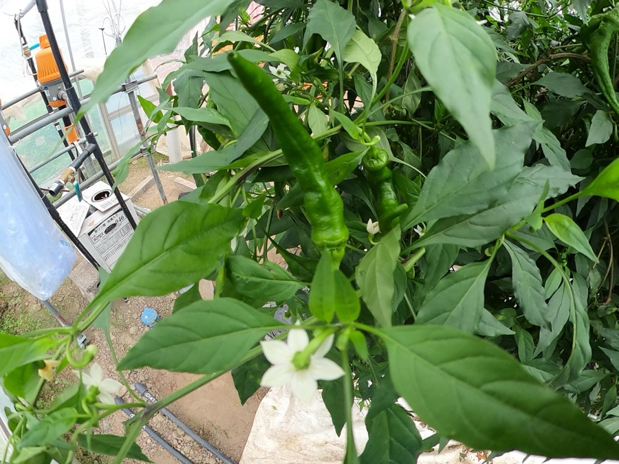
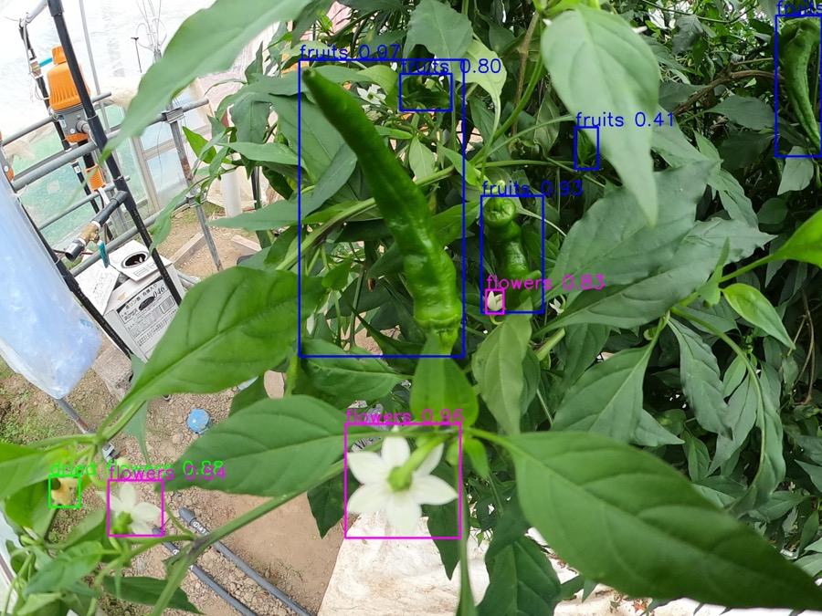
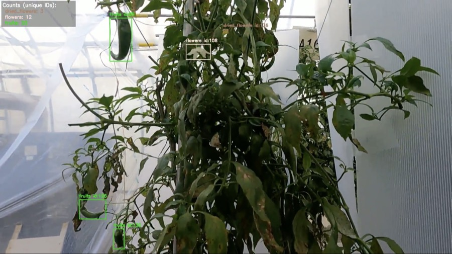

# 万願寺唐辛子の果実・花 自動カウントシステム
### Automated Fruit & Flower Counting for Manganji Pepper using Object Detection and Multi-Object Tracking

[](https://www.python.org/)
[](https://github.com/ultralytics/ultralytics)
[](LICENSE)

> 京都大学農学部 卒業研究（2025年度）  
> フィールドロボティクス研究室

---

## 概要

日本農業における担い手不足・高齢化を背景に、**京都府特産の万願寺唐辛子**を対象とした
果実・花の個体数自動計測システムを構築した。

圃場で撮影した動画に対し、物体検出（Object Detection）と多物体追跡（Multi-Object Tracking）を組み合わせることで、重複カウントを防ぎながら果実・花の個体数を推定する。

<table>
  <tr>
    <th>① 入力（温室で撮影）</th>
    <th>② 検出（RT-DETR）</th>
    <th>③ 追跡・カウント</th>
  </tr>
  <tr>
    <td><a href="images/input_sample.jpg"></a></td>
    <td><a href="images/detection_sample.jpg"></a></td>
    <td><a href="images/tracking_sample.jpg"></a></td>
  </tr>
</table>

<sub>画像クリックで原寸表示。③では個体ごとにIDを付与し、ユニークID数をクラス別に集計している。</sub>

**ポイント**
- 検出：YOLO系4モデルとRT-DETRを同条件（mサイズ）で比較し、オクルージョンに強い **RT-DETR を採用**（mAP@50 0.470）
- 追跡：4手法を比較し、**果実は BoostTrack、花は ByteTrack / BoT-SORT** とクラスの特性に応じて使い分けるべきことを示した
- 運用：信頼度閾値を 0.45〜0.90 で比較し、conf=0.75 を最適値として選定

---

## 研究の背景と課題

| 課題 | 詳細 |
|------|------|
| **目視カウントの限界** | 果実数・花数の把握は経験と目視に依存し、作業負担が大きく精度のばらつきも課題 |
| **万願寺唐辛子特有の困難** | 果実と葉が同色（緑）・細長い形状・オクルージョン（葉による遮蔽）が頻発 |
| **重複カウント問題** | 動画フレームをまたいで同一個体を別個体として数えてしまう |

---

## 使用技術

### 物体検出モデル
| モデル | アーキテクチャ | 特徴 |
|--------|--------------|------|
| YOLOv5mu | CNN (CSP-Darknet) | 実績あるベースライン |
| YOLOv8m | Anchor-free CNN | 高速・高精度のバランス |
| YOLO11m | 軽量最適化CNN | 処理速度と精度のバランス |
| YOLO12m | Attention機構導入 | 複雑背景での精度向上 |
| **RT-DETR** | **Transformer** | **追跡部分にて採用・最良性能** |

### 追跡モデル (Multi-Object Tracking)
| モデル | 特徴 |
|--------|------|
| **ByteTrack** | 低スコア検出も活用する2段階マッチング → **花クラスで最良** |
| **BoostTrack** | 一時的な検出消失への耐性が高い → **果実クラスで最良** |
| BoT-SORT | ByteTrackと同等の結果 |
| DeepSORT | Re-IDベース（今回の対象には不向きと判明） |

### その他
- **アノテーション**: Roboflow（3クラス：fruits / flowers / dried flowers）
- **実験環境**: Google Colab
- **撮影機材**: GoPro MAX, GoPro9
- **撮影場所**: 京都府農林水産技術センター内の万願寺とうがらし栽培用温室（亀岡市）

---

## 実験結果

### 物体検出モデルの比較（mサイズ統一）

| モデル | Precision | Recall | mAP@50 |
|--------|-----------|--------|--------|
| YOLOv5mu | 0.557 | 0.403 | 0.405 |
| YOLOv8m | 0.567 | 0.361 | 0.393 |
| YOLO11m | 0.491 | 0.284 | 0.297 |
| YOLO12m | 0.633 | 0.370 | 0.424 |
| **RT-DETR** | **0.671** | **0.416** | **0.470** |

→ RT-DETRがYOLO系全モデルを上回り最高精度を達成

### 追跡モデルの比較（conf=0.75 時点・最良組み合わせ）

| クラス | 最適追跡モデル | MAE | 相対誤差 |
|--------|-------------|-----|---------|
| 果実 (fruits) | **BoostTrack** | 7.0 | 29.2% |
| 花 (flowers) | **ByteTrack / BoT-SORT** | 3.4 | 39.5% |
| 枯花 (dried flowers) | **ByteTrack / BoT-SORT** | 2.6 | 34.2% |

→ 対象クラスの特性（外観・運動）に応じて最適な追跡手法が異なることを確認

---

## 主な知見・考察

- **RT-DETRの有効性**: TransformerのSelf-Attentionが、オクルージョンの多い農業環境での特徴抽出に効果的
- **BoostTrackの果実への適合**: 一時的な検出消失（遮蔽）後のID再接続が、葉に隠れやすい果実の追跡に貢献
- **ByteTrackの花への適合**: 小サイズ・低信頼度スコアの検出も2段階マッチングで活用できる点が、サイズの小さい花クラスに有効
- **信頼度閾値の重要性**: conf=0.75が最適値。クラスごとに動的な閾値設定が必要

---

## データセット

プライバシー・研究上の理由から画像・動画データセットは非公開です。

- **学習用静止画**: 2025年9月24日撮影
- **追跡評価用動画**: 2025年12月12日撮影
- **アノテーション数**: fruits 681件 / flowers 1,844件 / dried flowers 415件

---

## 環境構築

```bash
git clone https://github.com/Ugradcoder-ys/mangan-ji-pepper-counting.git
cd mangan-ji-pepper-counting
pip install -r requirements.txt
```

---

## 使い方

データセット・動画・学習済み重みは非公開のため、各自のデータでの実行例を示す。各スクリプトの引数は `--help` で確認できる。

```bash
# 検出モデルの学習（RT-DETR / YOLO系の比較）
python detect/detect_rtdetr.py train --data path/to/data.yaml
python detect/detect_yolo.py train --data path/to/data.yaml --models yolov8m.pt yolo12m.pt

# 検出（推論）
python detect/detect_rtdetr.py predict --weights best.pt --source path/to/images --conf 0.25

# 追跡・カウント（--tracker: bytetrack / botsort / boosttrack / deepsort）
python track/track.py --video input.mp4 --weights best.pt --tracker boosttrack --conf 0.75
```

---

## ディレクトリ構成

```
mangan-ji-pepper-counting/
├── detect/
│   ├── detect_rtdetr.py   # RT-DETR の学習・推論
│   └── detect_yolo.py     # YOLO系モデル（v5/v8/11/12）の学習・比較・推論
├── track/
│   └── track.py           # RT-DETR + 追跡（ByteTrack / BoT-SORT / BoostTrack / DeepSORT）による個体数カウント
├── notebooks/
│   └── rtdetr_boosttrack_colab.ipynb  # Google Colab 上での実験ノートブック（動画前処理・BoostTrack一括処理）
├── images/                # 入力・検出・追跡のサンプル画像（display/ は README 表示用の縮小版）
├── requirements.txt
└── LICENSE
```

---

## 参考文献

**物体検出**
- Y. Zhao et al., "DETRs Beat YOLOs on Real-time Object Detection," *CVPR*, 2024. [[arXiv:2304.08069]](https://arxiv.org/abs/2304.08069)
- Ultralytics, "Ultralytics YOLO Docs." [[docs.ultralytics.com]](https://docs.ultralytics.com/)

**多物体追跡**
- Y. Zhang et al., "ByteTrack: Multi-Object Tracking by Associating Every Detection Box," *ECCV*, 2022. [[arXiv:2110.06864]](https://arxiv.org/abs/2110.06864)
- V. Stanojević and B. Todorović, "BoostTrack: boosting the similarity measure and detection confidence for improved multiple object tracking," *Machine Vision and Applications*, vol. 35, art. 53, 2024. [[DOI]](https://doi.org/10.1007/s00138-024-01531-5) [[GitHub]](https://github.com/vukasin-stanojevic/BoostTrack)
- N. Aharon, R. Orfaig, and B.-Z. Bobrovsky, "BoT-SORT: Robust Associations Multi-Pedestrian Tracking," 2022. [[arXiv:2206.14651]](https://arxiv.org/abs/2206.14651)
- N. Wojke, A. Bewley, and D. Paulus, "Simple Online and Realtime Tracking with a Deep Association Metric," *ICIP*, 2017. [[arXiv:1703.07402]](https://arxiv.org/abs/1703.07402)

**実装に使用したライブラリ**
- [Ultralytics](https://github.com/ultralytics/ultralytics)（RT-DETR・YOLO の学習・推論、ByteTrack / BoT-SORT）
- [BoxMOT](https://github.com/mikel-brostrom/boxmot)（BoostTrack）
- [deep_sort_realtime](https://github.com/levan92/deep_sort_realtime)（DeepSORT）

---

## 現在の取り組み（修士研究）

本研究は修士課程でも継続しています。研究室の方針により、修士課程以降の研究内容（手法・結果・コード）は非公開としています。

---

## 著者

**山内 翔太**  
京都大学農学部地域環境工学科 フィールドロボティクス研究室  
GitHub: [@Ugradcoder-ys](https://github.com/Ugradcoder-ys)

---

## License

[MIT License](LICENSE)